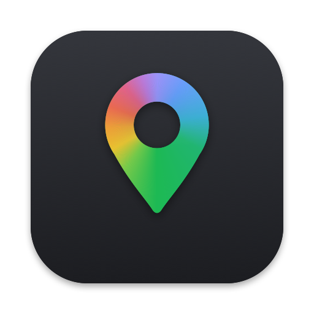

<p align="center">
  
</p>

<h1 align="center">Maps Desktop — Google Maps app for Mac with dark mode</h1>

<p align="center">
  <b>The Google Maps desktop app macOS never had.</b><br>
  Full Google Maps in a native Mac window, with a real dark mode, trackpad gestures and map links that open right in the app.
</p>

<p align="center">
  <a href="../../releases/latest"></a>
  
  
</p>

---

Google has no official Google Maps app for Mac, and the website in a browser tab has no dark mode, swallows trackpad swipes and gets lost among other tabs. **Maps Desktop** puts the complete Google Maps website — search, directions, Street View, reviews, saved places and your Google account — into its own lightweight Mac app and fixes exactly those things.

## Features

- 🌙 **Dark mode for Google Maps** — a dark theme for the whole interface and the map, with cool night-blue map colours. Photos, satellite view and Street View keep their real colours. Follows the macOS appearance automatically, or pick Light / Dark in **View ▸ Theme**.
- 🖐 **Trackpad gestures that make sense** — two-finger swipe pans the map like on a phone, pinch zooms, lists and panels scroll normally. In a browser, two-finger scroll only zooms Google Maps.
- 🔗 **Open Google Maps links in the app** — `google.com/maps`, `maps.google.com`, `maps.app.goo.gl` short links, `comgooglemaps://`, `geo:` and even Apple Maps links open in Maps Desktop. Everything that isn't a map goes straight to your usual browser (Chrome, Safari, Arc…).
- 🧩 **Chrome extension** — map links you click inside Chrome open in Maps Desktop too, without making the app your default browser.
- 📍 **My Location works** — Maps Desktop asks macOS for location access and passes your position to Google Maps, so the “show my location” button works on a Mac.
- 🔄 **Automatic updates** — new versions are downloaded from GitHub Releases and checked against a cryptographic signature before installing.
- 🌐 **Your language** — the app follows the macOS language (English and Russian included); Google Maps itself uses your system language too.
- 🪶 **Native and light** — under 2 MB, built with Swift, AppKit and WebKit. No Electron, no tracking, no API keys.
- ⌨️ **Mac keyboard shortcuts** — ⌘L / ⌘F search, ⇧⌘C copy link to the current place, ⇧⌘O open in browser, ⌘R reload, ⌘[ / ⌘] back and forward.

## Download and install

1. Download **MapsDesktop.zip** from the [latest release](../../releases/latest) and unzip it.
2. Move **Maps Desktop.app** to your **Applications** folder.
3. Open it. The first time, macOS warns that the developer can't be verified (Maps Desktop isn't notarized by Apple): open **System Settings ▸ Privacy & Security** and click **Open Anyway**. Or run once:
   ```bash
   xattr -dr com.apple.quarantine "/Applications/Maps Desktop.app"
   ```
4. Sign in to your Google account inside Maps Desktop to see saved places and history.

Updates install themselves from then on: **Maps Desktop ▸ Check for Updates…**

### Make map links open in Maps Desktop

There are two ways, use either or both:

**From Chrome — the Chrome extension.** Links to Google Maps you click in Chrome (or that other apps open in Chrome) go straight to Maps Desktop; your default browser stays the same.
1. Download the source (**Code ▸ Download ZIP**) or clone the repo.
2. Open `chrome://extensions`, turn on **Developer mode**, click **Load unpacked** and choose the `chrome-extension` folder.
3. The first time Chrome asks “Open Maps Desktop?” — tick **Always allow** and click **Open**.

Click the extension's button to pause or resume it. When you choose **File ▸ Open in Browser** in the app, the extension leaves that tab in Chrome.

**From any app — link handling.** macOS lets an app handle web links only for all of `http`/`https` at once. So Maps Desktop can do what link routers like Velja or Finicky do: choose **Maps Desktop ▸ Link Handling ▸ Open Map Links Here**, confirm the macOS prompt, and Maps Desktop keeps only map links and instantly forwards every other link to the browser you pick in the same menu. Turn it off there any time.

## FAQ

**Is there an official Google Maps app for Mac?**
No. Google offers Google Maps on the web, iPhone and Android only. Maps Desktop is an unofficial desktop app that shows the real Google Maps website.

**How do I open Google Maps links in an app instead of a browser on Mac?**
Install the Chrome extension, or turn on **Link Handling** in the app menu — see above.

**How do I get Google Maps dark mode on a Mac?**
The Google Maps website has no dark mode on desktop. Maps Desktop adds one that switches together with macOS.

**Does it need a Google Maps API key?**
No. It is the regular Google Maps website, so search, directions, Street View and your account work as usual.

**Why does a two-finger swipe move the map instead of zooming?**
That's the point: in Maps Desktop the trackpad behaves like in Apple Maps. Pinch to zoom.

**Is it safe?**
The source code is here, builds run on GitHub Actions, and every update is signed — the app refuses an update whose signature doesn't match.

## Build from source

Requires macOS 14+ and the Xcode Command Line Tools.

```bash
git clone https://github.com/donsamoylov/maps-desktop.git
cd maps-desktop
./build.sh --install
```

Releases are built by GitHub Actions when a `v*` tag is pushed — see [`.github/workflows/release.yml`](.github/workflows/release.yml).

## По-русски

**Maps Desktop — Google Карты для Mac с тёмной темой.** Полноценные Google Карты в отдельном окне macOS: тёмная тема в холодных тонах, которая переключается вместе с системой; свайп двумя пальцами двигает карту, щипок масштабирует; ссылки на Google Карты из Chrome (через расширение), Telegram, почты и других приложений открываются прямо в приложении; работает «Где я»; обновления приходят сами. Язык интерфейса — как в системе.

---

<sub>Maps Desktop is an independent open-source project. It is not affiliated with, endorsed by or sponsored by Google LLC. Google Maps is a trademark of Google LLC; the app simply displays the public Google Maps website, and its use is subject to Google's terms.</sub>
